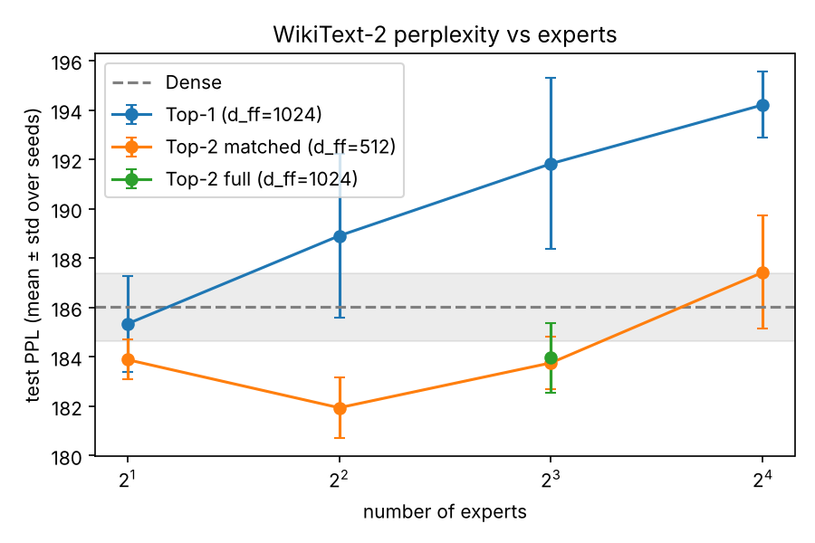
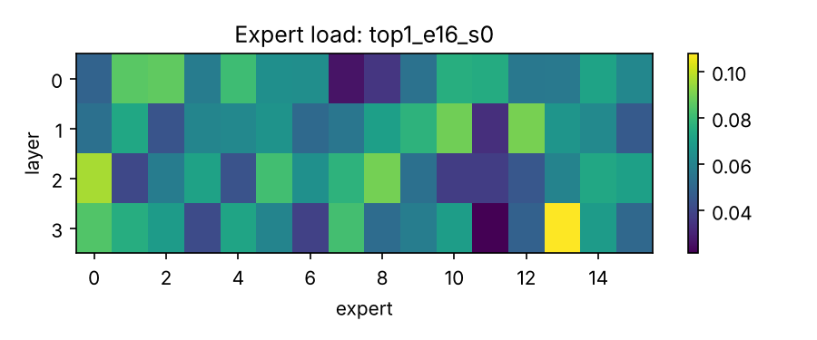
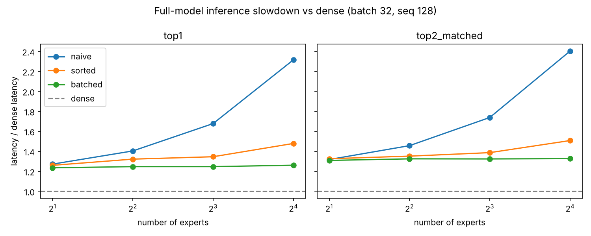

# Sparse Mixture-of-Experts Transformer: Quality vs GPU Cost

A decoder-only Transformer, built from scratch in PyTorch, with **Dense**, **Top-1** (Switch-style) and **Top-2** (GShard-style) **Sparse MoE** feed-forward layers. It's trained on WikiText-2 and profiled on an NVIDIA T4.

The project asks two questions:
1. **Does MoE improve language modelling at the same compute per token?** All MoE variants are compared at matched *active* FLOPs, over 3 seeds.
2. **Why is MoE slower than dense on a GPU, and how much of that can be fixed?** Profiling locates the bottlenecks; two optimizations (batched-GEMM dispatch, then a sort-based router) remove most of the overhead.

## Key results

| | |
|---|---|
| Best quality | **Top-2 MoE (4 experts): 181.9 ± 1.2 test PPL vs 186.0 ± 1.4 for Dense** at equal active FLOPs (−2.2%, better in all 3 seeds) |
| Dispatch optimization | MoE layer up to **3.8× faster**. Full-model inference overhead vs dense (16 experts) **2.4× → 1.3×**, training step **1.67× → 1.13×** |
| Router optimization | Router share of forward time **19% → 11%**, MoE layer up to **2.1× faster** at batch 64 |
| Negative findings | Top-1 MoE gets *worse* as experts are added (+4.4% PPL at 16 experts). The fast router doesn't help at batch 1 |

## 1. Language-modelling quality

WikiText-2 (raw), GPT-2 BPE tokenizer, 4 layers, d_model 256, 6000 steps × 4096 tokens, cosine LR, early stopping on validation. Test perplexity is the mean ± std over seeds 0, 1 and 2.

**Compute matching:** Dense uses d_ff = 1024. Top-1 uses experts with d_ff = 1024, and Top-2 ("matched") uses experts with d_ff = 512. Both therefore spend the same FFN FLOPs per token as Dense; only total parameters grow. "Top-2 full" (d_ff = 1024) uses 2× the FFN compute, as a control.

| Model | Experts | Total params | Active params | Test PPL | vs Dense |
|---|---|---|---|---|---|
| Dense | – | 16.0M | 16.0M | 186.0 ± 1.4 | – |
| Top-1 | 2 | 18.1M | 16.1M | 185.3 ± 1.9 | −0.4% |
| Top-1 | 4 | 22.3M | 16.1M | 188.9 ± 3.3 | +1.6% |
| Top-1 | 8 | 30.7M | 16.1M | 191.8 ± 3.5 | +3.1% |
| Top-1 | 16 | 47.5M | 16.1M | 194.2 ± 1.3 | +4.4% |
| Top-2 matched | 2 | 16.1M | 16.1M | 183.9 ± 0.8 | −1.1% |
| **Top-2 matched** | **4** | 18.2M | 16.1M | **181.9 ± 1.2** | **−2.2%** |
| Top-2 matched | 8 | 22.3M | 16.1M | 183.8 ± 1.1 | −1.2% |
| Top-2 matched | 16 | 30.7M | 16.1M | 187.4 ± 2.3 | +0.8% |
| Top-2 full (2× compute) | 8 | 30.7M | 18.2M | 184.0 ± 1.4 | −1.1% |



**Findings**
- **Top-2 MoE beats Dense at equal compute**, best at 4 experts. The gain holds within each seed (−3.4, −4.5 and −3.6 PPL vs the Dense run with the same seed), so it isn't seed noise.
- **Extra compute doesn't help:** Top-2 with 2× compute (184.0) is no better than compute-matched Top-2 (183.8). The benefit comes from routing, not from extra FLOPs.
- **Top-1 degrades as experts grow.** Each expert sees only ~1/E of the tokens, so on a 2.4M-token dataset the experts stay undertrained. Top-2 is more robust because each token trains two experts.
- **Routing is balanced but not uniform:** with Top-1 and 16 experts, the busiest expert receives 13.7% of tokens (uniform = 6.25%).



## 2. GPU cost: where MoE time goes and how to cut it

The expert FFN is implemented three ways. Unit tests confirm identical outputs **and gradients** across all three, with and without token dropping:

| Dispatch | How it works | Cost |
|---|---|---|
| `naive` | Python loop over experts, boolean mask + `nonzero()` per expert | E host↔device syncs, 2E gather/scatter |
| `sorted` | sort tokens by expert once, loop over contiguous slices | 1 sync, 1 gather, 1 scatter |
| `batched` | scatter tokens into a padded `[E, capacity, d]` buffer, **one `torch.bmm`** for all experts | no loop, no sync. Pays for padding FLOPs |

Measured on a Tesla T4 in fp16, using CUDA events (median of 30 runs) and `torch.profiler`.

**Full-model inference latency relative to Dense (batch 32, seq 128):**



The naive loop's overhead grows with the number of experts (up to 2.3–2.4× slower than dense at 16 experts). Batched dispatch stays flat at about 1.25–1.33× regardless of expert count.

| Setting (16 experts, seq 128) | Naive | Best optimized | Speed-up |
|---|---|---|---|
| Single MoE layer, Top-1, batch 32 | 5.53 ms | 1.52 ms | **3.6×** |
| Full model inference, Top-1, batch 32 | 2.32× dense | 1.26× dense | 1.84× |
| Full model inference, Top-2, batch 32 | 2.40× dense | 1.33× dense | 1.81× |
| Training step, Top-1, batch 32 | 1.67× dense | 1.13× dense | 1.48× |

**Share of forward time spent in MoE layers** (8 experts, batch 32): naive 37–48% → batched 20–22%.

### The router became the next bottleneck

After dispatch was fixed, the profiler showed the **router** taking ~18–19% of forward time, while the expert matmuls took only ~2–3%. The original router computed each token's slot in its expert's buffer with a `[k·N, E]` one-hot matrix and a cumsum, and it always computed the auxiliary losses. The fast router:
- computes slot positions with a single stable `argsort` + `bincount` (O(k·N) memory instead of O(k·N·E)). A unit test confirms identical positions, outputs and losses.
- skips the load-balancing and z-losses at inference, where they're unused.

| Router benchmark (batched dispatch, seq 128) | Original | Fast | Speed-up |
|---|---|---|---|
| MoE layer, Top-1, 8 experts, batch 64 | 4.16 ms | 1.98 ms | **2.1×** |
| MoE layer, Top-2, 8 experts, batch 64 | 4.72 ms | 2.40 ms | 2.0× |
| Full inference, Top-2, 16 experts, batch 64 | 1.59× dense | 1.27× dense | 1.26× |
| Router share of forward time (8 experts, batch 32) | 18–19% | 11–13% | |

**Where it doesn't help:** at batch 1, the sort's fixed overhead cancels the gain, and training steps are ~5% slower. At batch 1 even the optimized MoE is ~3.3× slower than dense, because the forward pass is dominated by kernel-launch latency rather than compute. Closing that gap would need kernel fusion or CUDA graphs.

### Batched dispatch is not always best

Batched dispatch wins clearly at small batches and many experts (launch/sync-bound). At large batches (64 × 512, 32k tokens per forward) the GPU is compute-bound, the padding from `capacity_factor` = 1.25 costs real FLOPs, and `sorted` dispatch is faster than `batched` in **all 24** measured configurations (by ~4–8% end-to-end). A production system would choose the dispatch strategy based on tokens per batch. The full sweep over batch sizes {1, 8, 32, 64}, sequence lengths {128, 512} and experts {2, 4, 8, 16} is in [`results/summary.md`](results/summary.md) and [`results/bench.csv`](results/bench.csv).

## Implementation

| Piece | Where |
|---|---|
| Decoder-only Transformer (pre-LN, causal SDPA attention, tied embeddings) | `moe/model.py` |
| Router: fp32 softmax, top-k, renormalized Top-2 gates | `MoEFFN._route` |
| Load-balancing loss (Switch: `E·Σ fᵢ·Pᵢ`) and router z-loss (ST-MoE) | `MoEFFN._route` |
| Expert capacity + token dropping (Top-1 choices prioritized over Top-2) | `MoEFFN._capacity`, `_positions` |
| Naive / sorted / batched dispatch | `MoEFFN._dispatch_*` |
| Parameter and analytic FLOP accounting | `Transformer.param_counts`, `flops_per_token` |
| WikiText-2 loading + GPT-2 tokenization | `moe/data.py` |
| Training (AMP fp16/bf16, AdamW, cosine LR, early stopping) | `train.py` |
| Latency / throughput / memory / FLOPs / profiler breakdown | `profile_moe.py` |
| Tables and plots | `analyze.py` |
| Correctness tests | `tests/test_moe.py` |

## Reproduce

```bash
pip install -r requirements.txt
python -m tests.test_moe                          # 6 correctness checks

# one run
python train.py --name top2m_e4_s0 --ffn moe --top_k 2 --n_experts 4 --d_ff 512 --steps 6000

# everything: 11 configs x 3 seeds, profiling, analysis
SEEDS="0 1 2" STEPS=6000 bash run_experiments.sh
python profile_moe.py --router_only
python analyze.py                                 # -> results/summary.md + plots
```

The experiments in this repo were run on Kaggle (2× Tesla T4, one training run per GPU). `colab_runner.ipynb` runs the same pipeline on Google Colab.

## Limitations

- Small scale: a 16M-parameter model on WikiText-2. Conclusions about Top-1 vs Top-2 and expert counts may not transfer to large models and datasets.
- Perplexity uses GPT-2 BPE tokens, so it isn't comparable to word-level WikiText-2 perplexities in the literature.
- Single-GPU only: no expert parallelism or all-to-all communication, which dominates MoE cost in multi-GPU training.
- The 50k-vocabulary LM head accounts for most FLOPs at this size, which dilutes MoE overhead in full-model numbers. Layer-level numbers are reported separately for this reason.
