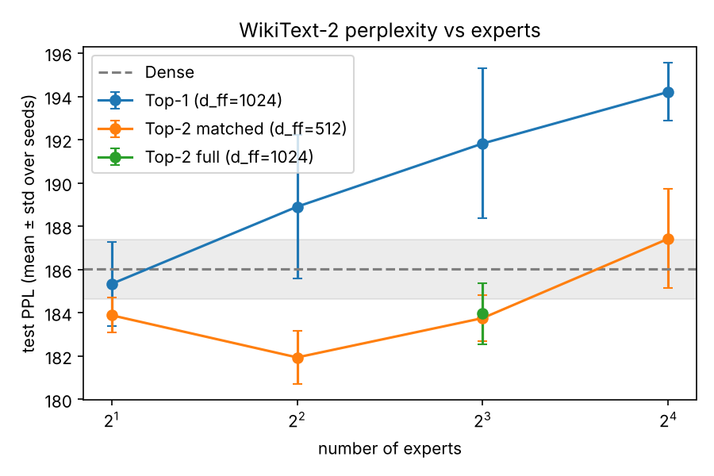
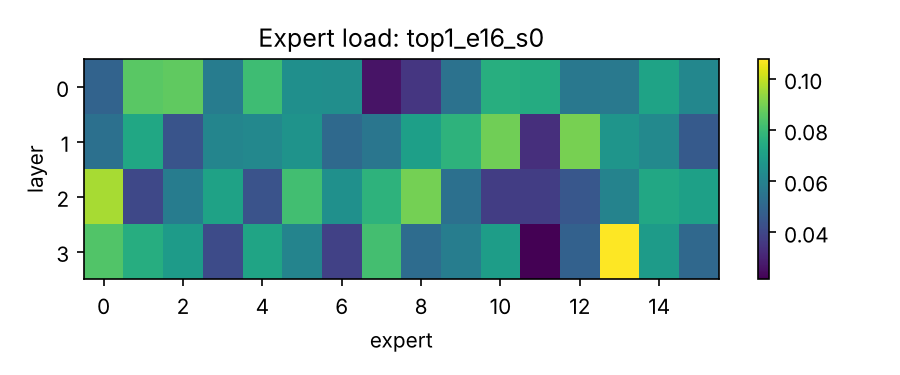
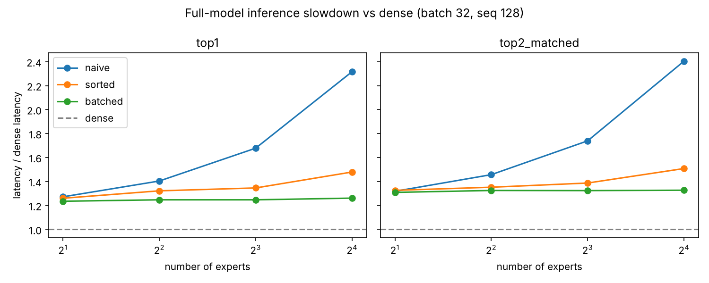
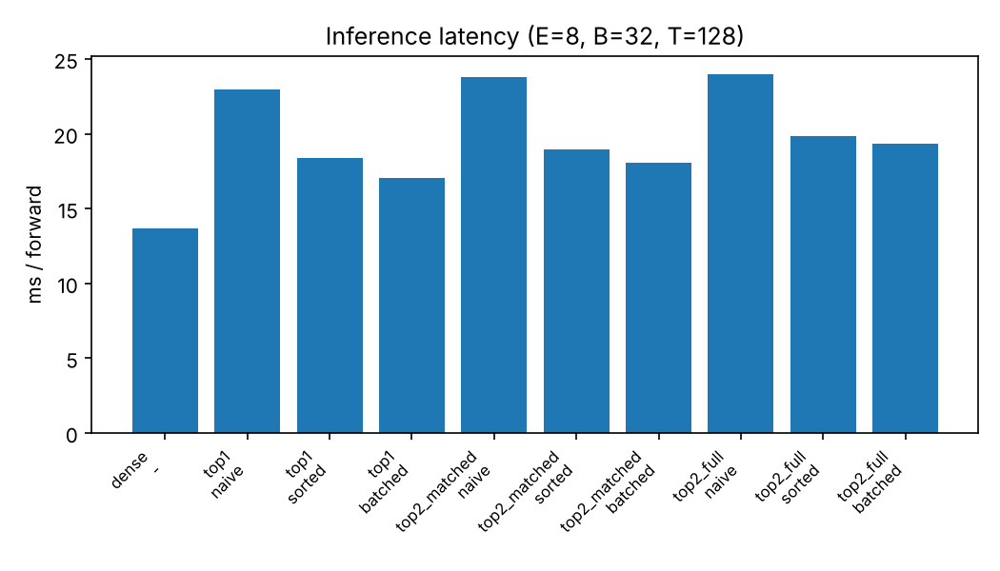

# Results

## Language modelling (WikiText-2 test perplexity, lower is better)

| Model | Seeds | Test PPL | Total params | Active params | Fwd GFLOPs/token | Train tok/s | Worst-layer max expert load |
|---|---|---|---|---|---|---|---|
| Dense (d_ff=1024) | 3 | 186.01 ± 1.37 | 16.0M | 16.0M | 0.0323 | 46,157 | - |
| Top-1 MoE, E=2, d_ff=1024 | 3 | 185.34 ± 1.94 | 18.1M | 16.1M | 0.0323 | 41,261 | 55% |
| Top-1 MoE, E=4, d_ff=1024 | 3 | 188.90 ± 3.32 | 22.3M | 16.1M | 0.0323 | 40,555 | 30% |
| Top-1 MoE, E=8, d_ff=1024 | 3 | 191.83 ± 3.47 | 30.7M | 16.1M | 0.0323 | 38,966 | 21% |
| Top-1 MoE, E=16, d_ff=1024 | 3 | 194.21 ± 1.33 | 47.5M | 16.1M | 0.0323 | 36,219 | 11% |
| Top-2 MoE, E=2, d_ff=512 | 3 | 183.89 ± 0.81 | 16.1M | 16.1M | 0.0323 | 40,511 | 50% |
| Top-2 MoE, E=4, d_ff=512 | 3 | 181.94 ± 1.22 | 18.2M | 16.1M | 0.0323 | 40,278 | 29% |
| Top-2 MoE, E=8, d_ff=512 | 3 | 183.76 ± 1.07 | 22.3M | 16.1M | 0.0323 | 39,386 | 16% |
| Top-2 MoE, E=8, d_ff=1024 | 3 | 183.96 ± 1.41 | 30.7M | 18.2M | 0.0365 | 36,617 | 15% |
| Top-2 MoE, E=16, d_ff=512 | 3 | 187.42 ± 2.29 | 30.7M | 16.1M | 0.0323 | 37,999 | 10% |

_Max expert load: share of routed tokens taken by the busiest expert (1/E is perfectly balanced)._

Dense baseline mean test PPL: 186.01





## Inference latency, E=8, batch 32, seq 128

| Variant | Dispatch | Latency (ms) | Tokens/s | Peak mem (MB) | Slowdown vs dense |
|---|---|---|---|---|---|
| dense | - | 13.665 | 299735 | 435.6 | 1.0 |
| top1 | naive | 22.937 | 178578 | 463.6 | 1.678 |
| top1 | sorted | 18.4 | 222605 | 463.6 | 1.346 |
| top1 | batched | 17.042 | 240348 | 463.6 | 1.247 |
| top2_matched | naive | 23.759 | 172398 | 447.6 | 1.739 |
| top2_matched | sorted | 18.95 | 216153 | 448.3 | 1.387 |
| top2_matched | batched | 18.094 | 226377 | 447.6 | 1.324 |
| top2_full | naive | 23.976 | 170838 | 463.6 | 1.754 |
| top2_full | sorted | 19.869 | 206150 | 463.6 | 1.454 |
| top2_full | batched | 19.354 | 211635 | 463.6 | 1.416 |

### Speed-up of optimised dispatch over the naive per-expert loop
(layer = one isolated FFN layer; inference = full model forward)

| Mode | Variant | E | Batch | Seq | Naive ms | Sorted ms | Batched ms | Best speed-up |
|---|---|---|---|---|---|---|---|---|
| layer | top1 | 2 | 1 | 128 | 1.612 | 1.584 | 1.43 | 1.13x |
| layer | top1 | 2 | 1 | 512 | 1.611 | 1.58 | 1.453 | 1.11x |
| layer | top1 | 2 | 8 | 128 | 1.641 | 1.577 | 1.464 | 1.12x |
| layer | top1 | 2 | 8 | 512 | 1.629 | 1.593 | 1.544 | 1.06x |
| layer | top1 | 2 | 32 | 128 | 1.642 | 1.584 | 1.495 | 1.10x |
| layer | top1 | 2 | 32 | 512 | 2.717 | 2.813 | 2.973 | 0.97x |
| layer | top1 | 2 | 64 | 128 | 1.79 | 1.921 | 1.936 | 0.93x |
| layer | top1 | 2 | 64 | 512 | 4.393 | 4.689 | 5.221 | 0.94x |
| layer | top1 | 4 | 1 | 128 | 2.147 | 1.702 | 1.462 | 1.47x |
| layer | top1 | 4 | 1 | 512 | 2.156 | 1.718 | 1.47 | 1.47x |
| layer | top1 | 4 | 8 | 128 | 2.159 | 1.708 | 1.426 | 1.51x |
| layer | top1 | 4 | 8 | 512 | 2.162 | 1.728 | 1.448 | 1.49x |
| layer | top1 | 4 | 32 | 128 | 2.15 | 1.738 | 1.455 | 1.48x |
| layer | top1 | 4 | 32 | 512 | 2.824 | 2.811 | 3.054 | 1.00x |
| layer | top1 | 4 | 64 | 128 | 2.276 | 1.979 | 1.936 | 1.18x |
| layer | top1 | 4 | 64 | 512 | 4.885 | 4.869 | 5.355 | 1.00x |
| layer | top1 | 8 | 1 | 128 | 3.271 | 1.971 | 1.425 | 2.30x |
| layer | top1 | 8 | 1 | 512 | 3.386 | 2.007 | 1.43 | 2.37x |
| layer | top1 | 8 | 8 | 128 | 3.348 | 2.011 | 1.43 | 2.34x |
| layer | top1 | 8 | 8 | 512 | 3.378 | 2.047 | 1.464 | 2.31x |
| layer | top1 | 8 | 32 | 128 | 3.285 | 2.037 | 1.47 | 2.23x |
| layer | top1 | 8 | 32 | 512 | 3.53 | 2.847 | 3.029 | 1.24x |
| layer | top1 | 8 | 64 | 128 | 3.407 | 2.355 | 1.938 | 1.76x |
| layer | top1 | 8 | 64 | 512 | 5.097 | 4.815 | 5.325 | 1.06x |
| layer | top1 | 16 | 1 | 128 | 5.432 | 2.516 | 1.424 | 3.81x |
| layer | top1 | 16 | 1 | 512 | 5.495 | 2.584 | 1.439 | 3.82x |
| layer | top1 | 16 | 8 | 128 | 5.515 | 2.517 | 1.441 | 3.83x |
| layer | top1 | 16 | 8 | 512 | 5.52 | 2.494 | 1.514 | 3.65x |
| layer | top1 | 16 | 32 | 128 | 5.531 | 2.52 | 1.521 | 3.64x |
| layer | top1 | 16 | 32 | 512 | 5.723 | 2.953 | 3.084 | 1.94x |
| layer | top1 | 16 | 64 | 128 | 5.676 | 2.608 | 1.968 | 2.88x |
| layer | top1 | 16 | 64 | 512 | 6.315 | 4.952 | 5.415 | 1.28x |
| layer | top2_matched | 2 | 1 | 128 | 1.657 | 1.644 | 1.538 | 1.08x |
| layer | top2_matched | 2 | 1 | 512 | 1.665 | 1.664 | 1.552 | 1.07x |
| layer | top2_matched | 2 | 8 | 128 | 1.7 | 1.672 | 1.547 | 1.10x |
| layer | top2_matched | 2 | 8 | 512 | 1.764 | 1.769 | 1.718 | 1.03x |
| layer | top2_matched | 2 | 32 | 128 | 1.756 | 1.754 | 1.71 | 1.03x |
| layer | top2_matched | 2 | 32 | 512 | 3.2 | 3.499 | 3.909 | 0.91x |
| layer | top2_matched | 2 | 64 | 128 | 2.133 | 2.311 | 2.381 | 0.92x |
| layer | top2_matched | 2 | 64 | 512 | 5.67 | 6.139 | 6.961 | 0.92x |
| layer | top2_matched | 4 | 1 | 128 | 2.232 | 1.777 | 1.535 | 1.45x |
| layer | top2_matched | 4 | 1 | 512 | 2.218 | 1.772 | 1.542 | 1.44x |
| layer | top2_matched | 4 | 8 | 128 | 2.219 | 1.764 | 1.565 | 1.42x |
| layer | top2_matched | 4 | 8 | 512 | 2.306 | 1.868 | 1.725 | 1.34x |
| layer | top2_matched | 4 | 32 | 128 | 2.302 | 1.857 | 1.72 | 1.34x |
| layer | top2_matched | 4 | 32 | 512 | 3.58 | 3.63 | 3.963 | 0.99x |
| layer | top2_matched | 4 | 64 | 128 | 2.549 | 2.321 | 2.385 | 1.10x |
| layer | top2_matched | 4 | 64 | 512 | 6.09 | 6.262 | 7.141 | 0.97x |
| layer | top2_matched | 8 | 1 | 128 | 3.313 | 2.042 | 1.508 | 2.20x |
| layer | top2_matched | 8 | 1 | 512 | 3.335 | 2.177 | 1.553 | 2.15x |
| layer | top2_matched | 8 | 8 | 128 | 3.35 | 2.044 | 1.535 | 2.18x |
| layer | top2_matched | 8 | 8 | 512 | 3.526 | 2.141 | 1.708 | 2.06x |
| layer | top2_matched | 8 | 32 | 128 | 3.455 | 2.468 | 1.829 | 1.89x |
| layer | top2_matched | 8 | 32 | 512 | 4.024 | 3.61 | 3.971 | 1.11x |
| layer | top2_matched | 8 | 64 | 128 | 3.556 | 2.274 | 2.383 | 1.56x |
| layer | top2_matched | 8 | 64 | 512 | 6.475 | 6.434 | 7.105 | 1.01x |
| layer | top2_matched | 16 | 1 | 128 | 5.614 | 2.577 | 1.547 | 3.63x |
| layer | top2_matched | 16 | 1 | 512 | 5.546 | 2.545 | 1.562 | 3.55x |
| layer | top2_matched | 16 | 8 | 128 | 5.444 | 2.539 | 1.541 | 3.53x |
| layer | top2_matched | 16 | 8 | 512 | 5.574 | 2.599 | 1.732 | 3.22x |
| layer | top2_matched | 16 | 32 | 128 | 5.594 | 2.6 | 1.735 | 3.22x |
| layer | top2_matched | 16 | 32 | 512 | 5.909 | 3.566 | 4.041 | 1.66x |
| layer | top2_matched | 16 | 64 | 128 | 5.796 | 2.805 | 2.408 | 2.41x |
| layer | top2_matched | 16 | 64 | 512 | 7.359 | 6.547 | 7.215 | 1.12x |
| layer | top2_full | 2 | 1 | 128 | 1.694 | 1.684 | 1.544 | 1.10x |
| layer | top2_full | 2 | 1 | 512 | 1.662 | 1.651 | 1.555 | 1.07x |
| layer | top2_full | 2 | 8 | 128 | 1.653 | 1.652 | 1.536 | 1.08x |
| layer | top2_full | 2 | 8 | 512 | 1.831 | 1.935 | 1.951 | 0.95x |
| layer | top2_full | 2 | 32 | 128 | 1.825 | 1.948 | 1.966 | 0.94x |
| layer | top2_full | 2 | 32 | 512 | 4.341 | 4.622 | 5.181 | 0.94x |
| layer | top2_full | 2 | 64 | 128 | 2.537 | 2.725 | 2.955 | 0.93x |
| layer | top2_full | 2 | 64 | 512 | 8.423 | 8.659 | 9.999 | 0.97x |
| layer | top2_full | 4 | 1 | 128 | 2.282 | 1.806 | 1.552 | 1.47x |
| layer | top2_full | 4 | 1 | 512 | 2.266 | 1.791 | 1.546 | 1.47x |
| layer | top2_full | 4 | 8 | 128 | 2.472 | 1.776 | 1.546 | 1.60x |
| layer | top2_full | 4 | 8 | 512 | 2.332 | 1.958 | 1.961 | 1.19x |
| layer | top2_full | 4 | 32 | 128 | 2.336 | 1.959 | 1.956 | 1.19x |
| layer | top2_full | 4 | 32 | 512 | 4.614 | 4.83 | 5.276 | 0.96x |
| layer | top2_full | 4 | 64 | 128 | 2.815 | 2.762 | 3.016 | 1.02x |
| layer | top2_full | 4 | 64 | 512 | 8.361 | 8.732 | 10.017 | 0.96x |
| layer | top2_full | 8 | 1 | 128 | 3.302 | 2.026 | 1.56 | 2.12x |
| layer | top2_full | 8 | 1 | 512 | 3.317 | 2.039 | 1.567 | 2.12x |
| layer | top2_full | 8 | 8 | 128 | 3.294 | 2.094 | 1.58 | 2.08x |
| layer | top2_full | 8 | 8 | 512 | 3.366 | 2.175 | 1.988 | 1.69x |
| layer | top2_full | 8 | 32 | 128 | 3.37 | 2.168 | 1.972 | 1.71x |
| layer | top2_full | 8 | 32 | 512 | 5.034 | 4.692 | 5.311 | 1.07x |
| layer | top2_full | 8 | 64 | 128 | 3.501 | 2.829 | 3.043 | 1.24x |
| layer | top2_full | 8 | 64 | 512 | 8.811 | 8.662 | 10.017 | 1.02x |
| layer | top2_full | 16 | 1 | 128 | 5.717 | 2.572 | 1.546 | 3.70x |
| layer | top2_full | 16 | 1 | 512 | 5.595 | 2.598 | 1.557 | 3.59x |
| layer | top2_full | 16 | 8 | 128 | 5.764 | 2.577 | 1.562 | 3.69x |
| layer | top2_full | 16 | 8 | 512 | 5.886 | 2.628 | 2.0 | 2.94x |
| layer | top2_full | 16 | 32 | 128 | 5.71 | 2.786 | 2.008 | 2.84x |
| layer | top2_full | 16 | 32 | 512 | 6.125 | 4.901 | 5.309 | 1.25x |
| layer | top2_full | 16 | 64 | 128 | 5.742 | 2.931 | 3.099 | 1.96x |
| layer | top2_full | 16 | 64 | 512 | 9.545 | 8.798 | 10.051 | 1.08x |
| inference | top1 | 2 | 1 | 128 | 7.839 | 7.793 | 7.29 | 1.08x |
| inference | top1 | 2 | 1 | 512 | 8.722 | 8.688 | 8.194 | 1.06x |
| inference | top1 | 2 | 8 | 128 | 10.398 | 9.977 | 9.648 | 1.08x |
| inference | top1 | 2 | 8 | 512 | 17.383 | 17.336 | 17.023 | 1.02x |
| inference | top1 | 2 | 32 | 128 | 17.38 | 17.22 | 16.883 | 1.03x |
| inference | top1 | 2 | 32 | 512 | 59.194 | 60.483 | 61.168 | 0.98x |
| inference | top1 | 2 | 64 | 128 | 30.436 | 30.305 | 31.249 | 1.00x |
| inference | top1 | 2 | 64 | 512 | 119.055 | 117.457 | 121.376 | 1.01x |
| inference | top1 | 4 | 1 | 128 | 9.771 | 8.283 | 7.399 | 1.32x |
| inference | top1 | 4 | 1 | 512 | 10.852 | 9.195 | 8.276 | 1.31x |
| inference | top1 | 4 | 8 | 128 | 12.532 | 10.988 | 9.875 | 1.27x |
| inference | top1 | 4 | 8 | 512 | 18.975 | 17.768 | 17.27 | 1.10x |
| inference | top1 | 4 | 32 | 128 | 19.191 | 18.066 | 17.037 | 1.13x |
| inference | top1 | 4 | 32 | 512 | 59.113 | 60.009 | 61.649 | 0.99x |
| inference | top1 | 4 | 64 | 128 | 31.481 | 30.727 | 31.448 | 1.02x |
| inference | top1 | 4 | 64 | 512 | 116.586 | 117.191 | 122.778 | 0.99x |
| inference | top1 | 8 | 1 | 128 | 12.383 | 8.751 | 7.23 | 1.71x |
| inference | top1 | 8 | 1 | 512 | 13.401 | 9.624 | 8.167 | 1.64x |
| inference | top1 | 8 | 8 | 128 | 17.128 | 11.771 | 10.017 | 1.71x |
| inference | top1 | 8 | 8 | 512 | 23.082 | 18.413 | 17.301 | 1.33x |
| inference | top1 | 8 | 32 | 128 | 22.937 | 18.4 | 17.042 | 1.35x |
| inference | top1 | 8 | 32 | 512 | 61.415 | 59.224 | 61.118 | 1.04x |
| inference | top1 | 8 | 64 | 128 | 34.504 | 30.902 | 31.484 | 1.12x |
| inference | top1 | 8 | 64 | 512 | 116.09 | 115.774 | 121.678 | 1.00x |
| inference | top1 | 16 | 1 | 128 | 17.77 | 10.169 | 7.306 | 2.43x |
| inference | top1 | 16 | 1 | 512 | 22.387 | 11.866 | 8.307 | 2.69x |
| inference | top1 | 16 | 8 | 128 | 25.031 | 13.534 | 9.687 | 2.58x |
| inference | top1 | 16 | 8 | 512 | 31.447 | 20.138 | 17.396 | 1.81x |
| inference | top1 | 16 | 32 | 128 | 31.654 | 20.207 | 17.232 | 1.84x |
| inference | top1 | 16 | 32 | 512 | 67.358 | 60.289 | 61.624 | 1.12x |
| inference | top1 | 16 | 64 | 128 | 42.011 | 32.739 | 31.591 | 1.33x |
| inference | top1 | 16 | 64 | 512 | 121.426 | 116.99 | 123.421 | 1.04x |
| inference | top2_matched | 2 | 1 | 128 | 8.154 | 8.05 | 7.849 | 1.04x |
| inference | top2_matched | 2 | 1 | 512 | 8.997 | 8.874 | 8.682 | 1.04x |
| inference | top2_matched | 2 | 8 | 128 | 10.016 | 9.83 | 9.714 | 1.03x |
| inference | top2_matched | 2 | 8 | 512 | 18.068 | 18.204 | 18.31 | 0.99x |
| inference | top2_matched | 2 | 32 | 128 | 18.008 | 18.119 | 17.892 | 1.01x |
| inference | top2_matched | 2 | 32 | 512 | 62.78 | 63.442 | 64.995 | 0.99x |
| inference | top2_matched | 2 | 64 | 128 | 32.325 | 32.566 | 33.185 | 0.99x |
| inference | top2_matched | 2 | 64 | 512 | 125.001 | 124.702 | 128.526 | 1.00x |
| inference | top2_matched | 4 | 1 | 128 | 10.274 | 8.524 | 7.832 | 1.31x |
| inference | top2_matched | 4 | 1 | 512 | 11.37 | 9.745 | 8.49 | 1.34x |
| inference | top2_matched | 4 | 8 | 128 | 13.129 | 11.385 | 10.442 | 1.26x |
| inference | top2_matched | 4 | 8 | 512 | 20.161 | 18.448 | 18.434 | 1.09x |
| inference | top2_matched | 4 | 32 | 128 | 19.912 | 18.476 | 18.106 | 1.10x |
| inference | top2_matched | 4 | 32 | 512 | 62.054 | 62.741 | 65.269 | 0.99x |
| inference | top2_matched | 4 | 64 | 128 | 32.684 | 32.422 | 33.359 | 1.01x |
| inference | top2_matched | 4 | 64 | 512 | 122.842 | 125.373 | 130.549 | 0.98x |
| inference | top2_matched | 8 | 1 | 128 | 14.439 | 9.544 | 7.621 | 1.89x |
| inference | top2_matched | 8 | 1 | 512 | 16.073 | 10.303 | 8.441 | 1.90x |
| inference | top2_matched | 8 | 8 | 128 | 18.231 | 12.342 | 9.983 | 1.83x |
| inference | top2_matched | 8 | 8 | 512 | 23.835 | 19.471 | 18.275 | 1.30x |
| inference | top2_matched | 8 | 32 | 128 | 23.759 | 18.95 | 18.094 | 1.31x |
| inference | top2_matched | 8 | 32 | 512 | 63.505 | 62.388 | 65.226 | 1.02x |
| inference | top2_matched | 8 | 64 | 128 | 35.124 | 31.908 | 33.242 | 1.10x |
| inference | top2_matched | 8 | 64 | 512 | 124.365 | 123.19 | 129.39 | 1.01x |
| inference | top2_matched | 16 | 1 | 128 | 19.306 | 10.815 | 7.817 | 2.47x |
| inference | top2_matched | 16 | 1 | 512 | 22.25 | 12.015 | 8.522 | 2.61x |
| inference | top2_matched | 16 | 8 | 128 | 27.46 | 14.292 | 10.335 | 2.66x |
| inference | top2_matched | 16 | 8 | 512 | 32.953 | 20.256 | 18.409 | 1.79x |
| inference | top2_matched | 16 | 32 | 128 | 32.851 | 20.614 | 18.136 | 1.81x |
| inference | top2_matched | 16 | 32 | 512 | 67.997 | 62.241 | 64.989 | 1.09x |
| inference | top2_matched | 16 | 64 | 128 | 42.361 | 33.305 | 33.236 | 1.27x |
| inference | top2_matched | 16 | 64 | 512 | 125.279 | 122.352 | 130.009 | 1.02x |
| inference | top2_full | 2 | 1 | 128 | 8.202 | 8.189 | 7.822 | 1.05x |
| inference | top2_full | 2 | 1 | 512 | 8.899 | 9.015 | 8.433 | 1.06x |
| inference | top2_full | 2 | 8 | 128 | 10.231 | 10.638 | 9.96 | 1.03x |
| inference | top2_full | 2 | 8 | 512 | 18.876 | 19.468 | 19.489 | 0.97x |
| inference | top2_full | 2 | 32 | 128 | 18.986 | 19.269 | 19.32 | 0.99x |
| inference | top2_full | 2 | 32 | 512 | 67.542 | 68.074 | 70.859 | 0.99x |
| inference | top2_full | 2 | 64 | 128 | 34.286 | 34.916 | 35.738 | 0.98x |
| inference | top2_full | 2 | 64 | 512 | 138.611 | 137.317 | 142.324 | 1.01x |
| inference | top2_full | 4 | 1 | 128 | 10.517 | 8.559 | 7.872 | 1.34x |
| inference | top2_full | 4 | 1 | 512 | 11.597 | 9.463 | 8.526 | 1.36x |
| inference | top2_full | 4 | 8 | 128 | 12.886 | 10.903 | 10.118 | 1.27x |
| inference | top2_full | 4 | 8 | 512 | 20.106 | 19.267 | 19.909 | 1.04x |
| inference | top2_full | 4 | 32 | 128 | 20.032 | 18.867 | 19.454 | 1.06x |
| inference | top2_full | 4 | 32 | 512 | 66.331 | 67.041 | 71.068 | 0.99x |
| inference | top2_full | 4 | 64 | 128 | 34.215 | 34.529 | 36.177 | 0.99x |
| inference | top2_full | 4 | 64 | 512 | 133.457 | 135.866 | 142.29 | 0.98x |
| inference | top2_full | 8 | 1 | 128 | 14.165 | 9.757 | 7.763 | 1.82x |
| inference | top2_full | 8 | 1 | 512 | 15.803 | 10.632 | 8.534 | 1.85x |
| inference | top2_full | 8 | 8 | 128 | 18.016 | 12.449 | 10.165 | 1.77x |
| inference | top2_full | 8 | 8 | 512 | 24.044 | 20.224 | 19.964 | 1.20x |
| inference | top2_full | 8 | 32 | 128 | 23.976 | 19.869 | 19.354 | 1.24x |
| inference | top2_full | 8 | 32 | 512 | 67.167 | 66.487 | 70.715 | 1.01x |
| inference | top2_full | 8 | 64 | 128 | 36.54 | 33.67 | 35.563 | 1.09x |
| inference | top2_full | 8 | 64 | 512 | 131.973 | 132.407 | 142.015 | 1.00x |
| inference | top2_full | 16 | 1 | 128 | 21.37 | 10.761 | 7.618 | 2.81x |
| inference | top2_full | 16 | 1 | 512 | 25.667 | 13.42 | 8.485 | 3.02x |
| inference | top2_full | 16 | 8 | 128 | 27.428 | 14.601 | 9.961 | 2.75x |
| inference | top2_full | 16 | 8 | 512 | 32.312 | 21.241 | 20.005 | 1.62x |
| inference | top2_full | 16 | 32 | 128 | 32.508 | 21.237 | 19.386 | 1.68x |
| inference | top2_full | 16 | 32 | 512 | 71.21 | 67.171 | 70.273 | 1.06x |
| inference | top2_full | 16 | 64 | 128 | 43.129 | 34.746 | 35.663 | 1.24x |
| inference | top2_full | 16 | 64 | 512 | 133.338 | 131.733 | 141.609 | 1.01x |





## Where MoE time goes (% of total device time in forward, E=8, B=32, T=128)

```
{
  "top1/naive": {
    "moe/router": 11.22,
    "moe/naive_dispatch_and_compute": 36.42,
    "moe_total_pct": 47.64
  },
  "top2_matched/naive": {
    "moe/router": 8.79,
    "moe/naive_dispatch_and_compute": 28.18,
    "moe_total_pct": 36.97
  },
  "top1/sorted": {
    "moe/router": 10.61,
    "moe/sorted_dispatch_and_compute": 17.71,
    "moe_total_pct": 28.32
  },
  "top2_matched/sorted": {
    "moe/router": 11.62,
    "moe/sorted_dispatch_and_compute": 17.59,
    "moe_total_pct": 29.21
  },
  "top1/batched": {
    "moe/router": 11.83,
    "moe/dispatch": 3.55,
    "moe/expert_compute": 3.19,
    "moe/combine": 1.38,
    "moe_total_pct": 19.95
  },
  "top2_matched/batched": {
    "moe/router": 12.79,
    "moe/dispatch": 3.85,
    "moe/expert_compute": 3.08,
    "moe/combine": 2.26,
    "moe_total_pct": 21.98
  }
}
```

## Router optimisation (batched dispatch, seq 128)

| Mode | Variant | E | Batch | Dense ms | Original router ms | Fast router ms | Speed-up | Slowdown vs dense (orig → fast) |
|---|---|---|---|---|---|---|---|---|
| layer | top1 | 8 | 1 | 0.182 | 1.535 | 1.499 | 1.024x | 8.434x → 8.236x |
| layer | top1 | 8 | 32 | 0.254 | 2.84 | 1.832 | 1.55x | 11.181x → 7.213x |
| layer | top1 | 8 | 64 | 0.462 | 4.164 | 1.977 | 2.106x | 9.013x → 4.279x |
| layer | top1 | 16 | 1 | 0.182 | 1.556 | 1.474 | 1.056x | 8.549x → 8.099x |
| layer | top1 | 16 | 32 | 0.254 | 2.045 | 1.567 | 1.305x | 8.051x → 6.169x |
| layer | top1 | 16 | 64 | 0.462 | 3.084 | 1.987 | 1.552x | 6.675x → 4.301x |
| layer | top2_matched | 8 | 1 | 0.182 | 1.64 | 1.569 | 1.045x | 9.011x → 8.621x |
| layer | top2_matched | 8 | 32 | 0.254 | 2.809 | 1.758 | 1.598x | 11.059x → 6.921x |
| layer | top2_matched | 8 | 64 | 0.462 | 4.719 | 2.396 | 1.97x | 10.214x → 5.186x |
| layer | top2_matched | 16 | 1 | 0.182 | 1.63 | 1.577 | 1.034x | 8.956x → 8.665x |
| layer | top2_matched | 16 | 32 | 0.254 | 2.854 | 1.779 | 1.604x | 11.236x → 7.004x |
| layer | top2_matched | 16 | 64 | 0.462 | 4.816 | 2.45 | 1.966x | 10.424x → 5.303x |
| inference | top1 | 8 | 1 | 2.306 | 8.112 | 8.0 | 1.014x | 3.518x → 3.469x |
| inference | top1 | 8 | 32 | 13.47 | 19.11 | 17.066 | 1.12x | 1.419x → 1.267x |
| inference | top1 | 8 | 64 | 26.95 | 35.325 | 31.726 | 1.113x | 1.311x → 1.177x |
| inference | top1 | 16 | 1 | 2.306 | 8.108 | 8.02 | 1.011x | 3.516x → 3.478x |
| inference | top1 | 16 | 32 | 13.47 | 19.74 | 17.404 | 1.134x | 1.465x → 1.292x |
| inference | top1 | 16 | 64 | 26.95 | 36.356 | 32.024 | 1.135x | 1.349x → 1.188x |
| inference | top2_matched | 8 | 1 | 2.306 | 8.244 | 8.246 | 1.0x | 3.575x → 3.576x |
| inference | top2_matched | 8 | 32 | 13.47 | 22.019 | 18.591 | 1.184x | 1.635x → 1.38x |
| inference | top2_matched | 8 | 64 | 26.95 | 42.231 | 34.227 | 1.234x | 1.567x → 1.27x |
| inference | top2_matched | 16 | 1 | 2.306 | 8.509 | 8.358 | 1.018x | 3.69x → 3.624x |
| inference | top2_matched | 16 | 32 | 13.47 | 22.363 | 18.767 | 1.192x | 1.66x → 1.393x |
| inference | top2_matched | 16 | 64 | 26.95 | 42.956 | 34.125 | 1.259x | 1.594x → 1.266x |
| train | top1 | 8 | 1 | 5.801 | 15.297 | 16.14 | 0.948x | 2.637x → 2.782x |
| train | top1 | 8 | 32 | 73.087 | 82.564 | 81.406 | 1.014x | 1.13x → 1.114x |
| train | top1 | 8 | 64 | 144.743 | 159.047 | 156.675 | 1.015x | 1.099x → 1.082x |
| train | top1 | 16 | 1 | 5.801 | 15.547 | 16.316 | 0.953x | 2.68x → 2.813x |
| train | top1 | 16 | 32 | 73.087 | 82.249 | 81.211 | 1.013x | 1.125x → 1.111x |
| train | top1 | 16 | 64 | 144.743 | 158.364 | 155.298 | 1.02x | 1.094x → 1.073x |
| train | top2_matched | 8 | 1 | 5.801 | 16.312 | 17.02 | 0.958x | 2.812x → 2.934x |
| train | top2_matched | 8 | 32 | 73.087 | 88.346 | 83.331 | 1.06x | 1.209x → 1.14x |
| train | top2_matched | 8 | 64 | 144.743 | 171.813 | 162.482 | 1.057x | 1.187x → 1.123x |
| train | top2_matched | 16 | 1 | 5.801 | 16.286 | 16.972 | 0.96x | 2.807x → 2.926x |
| train | top2_matched | 16 | 32 | 73.087 | 87.601 | 82.796 | 1.058x | 1.199x → 1.133x |
| train | top2_matched | 16 | 64 | 144.743 | 168.955 | 159.056 | 1.062x | 1.167x → 1.099x |

## Time breakdown, original vs fast router (% of forward, E=8, B=32)

```
{
  "top1/batched/orig_router": {
    "moe/router": 18.3,
    "moe/dispatch": 3.42,
    "moe/expert_compute": 2.72,
    "moe/combine": 1.53,
    "moe_total_pct": 25.97
  },
  "top1/batched/fast_router": {
    "moe/router": 10.71,
    "moe/dispatch": 3.14,
    "moe/expert_compute": 3.19,
    "moe/combine": 1.32,
    "moe_total_pct": 18.36
  },
  "top2_matched/batched/orig_router": {
    "moe/router": 19.11,
    "moe/dispatch": 2.71,
    "moe/expert_compute": 2.16,
    "moe/combine": 1.57,
    "moe_total_pct": 25.55
  },
  "top2_matched/batched/fast_router": {
    "moe/router": 12.57,
    "moe/dispatch": 3.92,
    "moe/expert_compute": 2.93,
    "moe/combine": 2.27,
    "moe_total_pct": 21.69
  }
}
```